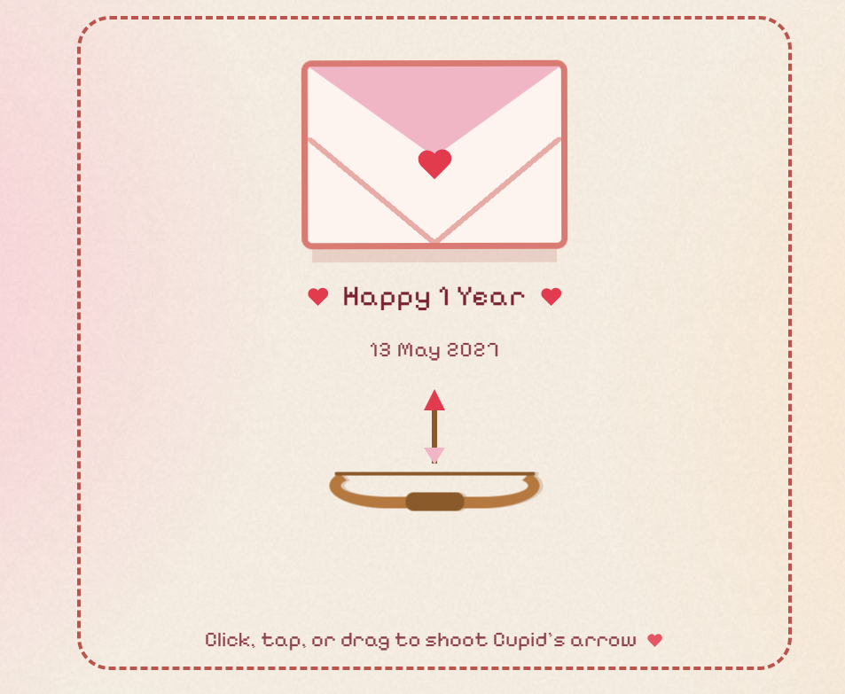
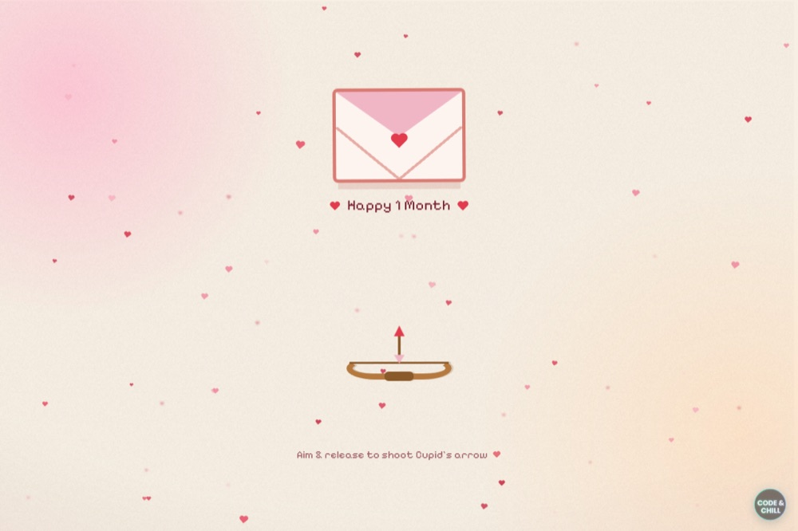

# Interactive Pixel-Art Love Letter 💌

A cute, interactive **pixel-art web letter** celebrating **1 month and 18 days of relationship** (12 October 2026). Built with pure HTML, CSS, and Vanilla JavaScript.

Aim Cupid's bow, release to fire the arrow at the floating envelope, and a retro **"LOVE"** window pops open to reveal a cute pixel-art cat. Answer the question — and watch the screen fill with falling hearts and confetti! 🎯💖

[](https://365daysus.netlify.app/)
&nbsp;

&nbsp;

&nbsp;


### 🌐 **[Open Live Demo: 365daysus.netlify.app →](https://365daysus.netlify.app/)**

<sub>Created with love by **hxni** ([@the.cipher.stack](https://www.instagram.com/the.cipher.stack)) 💖</sub>

---

## 📸 Demo Screenshots

| Aim & Shoot (Cupid's Bow) | Interactive Letter Preview |
| :---: | :---: |
|  |  |

---

## ✨ Features

- 🏹 **Interactive Bow & Arrow Physics**: Aim with your mouse or finger, hold to charge tension, and release to loose Cupid's arrow. Supports keyboard controls (`Space` / `Enter`).
- 🎯 **Target Hit Collision**: The envelope **only opens when hit by the arrow**. Missed shots trigger helpful hint prompts ("So close — try again ♡") and reset the bow for another try.
- 💌 **Retro Pixel-Art Reveal**: Hitting the envelope opens a nostalgic pixel-art "LOVE" window featuring an animated cat holding a heart.
- 😉 **Dodging "NO" Button**: A playful "NO" button that dodges your cursor/touch, while the "YES" button grows more tempting.
- 🎉 **Confetti & Heart Rain Celebration**: Interactive particle cannons launch heart confetti high into the air with real gravity physics upon saying YES.
- 📱 **100% Responsive & Mobile-Friendly**: Designed for desktop screens, mobile devices, and touch displays.
- ⚡ **Zero Dependencies & Offline Ready**: 100% vanilla web technology with zero frameworks or build tooling.

---

## 🎮 How to Play

1. **Aim** — Move your cursor (or touch and drag on mobile) to aim Cupid's bow.
2. **Shoot** — Release (or single-click/tap) to fire the arrow at the envelope.
3. **Hit the Envelope** — Upon a successful hit, the envelope wobbles and opens into the **LOVE** window.
4. **Answer the Question** — Click **YES** (if you try to click **NO**, it dodges! 😉).
5. **Celebrate** — Enjoy the floating hearts and confetti cannons. Click **✕** to replay.

---

## 🚀 Getting Started

No installation or build tools required.

### Quick Start
Simply **double-click `index.html`** in your File Explorer to open it directly in any browser.

### Local Development Server
Alternatively, serve the directory locally using Python:

```bash
# Run inside the project directory:
python -m http.server 8000
# → Open http://localhost:8000 in your browser
```

### Live Site
The card is deployed live on Netlify:
👉 **[https://365daysus.netlify.app/](https://365daysus.netlify.app/)**

---

## 📁 Project Structure

```
love-letter/
├── index.html      # Main HTML structure & letter layout
├── love.css        # Visual styling, pixel art, & animations
├── love.js         # Interactive physics, archery engine, & confetti
├── favicon.png     # Browser tab icon
├── demo.png        # Live demo screenshot
├── preview.jpg     # Screenshot preview
└── textures/
    └── grain.png   # Atmospheric background film-grain texture
```

---

## 🛠️ Built With

- **HTML5**: Semantic web document structure.
- **CSS3**: Custom pixel typography (`Press Start 2P`, `Pixelify Sans`), Gingham pattern gradients, CSS transforms, and keyframe animations.
- **Vanilla JavaScript**: Pure JS physics engine for projectile math, collision detection, and canvas sprite rendering.

---

## 👤 Credits

- **Author / Designer**: **hxni**
- **Instagram**: [@the.cipher.stack](https://www.instagram.com/the.cipher.stack)

---

## 📄 License

This project is licensed under the [MIT License](LICENSE) — feel free to use, modify, and share it with love. ♡
